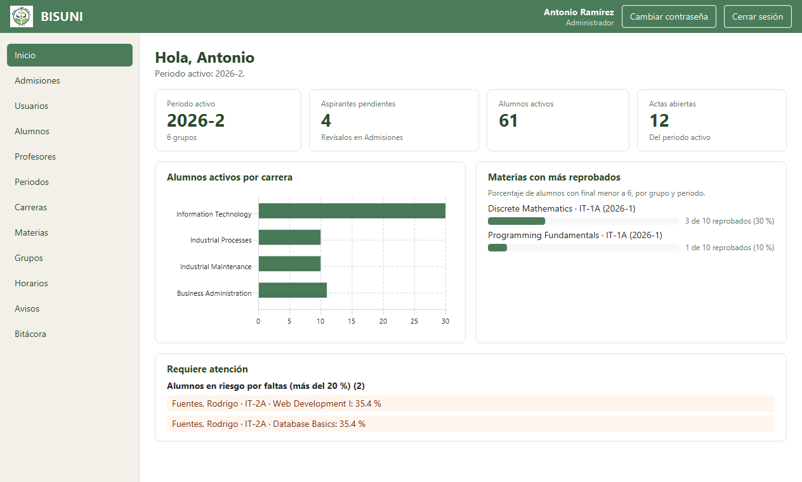
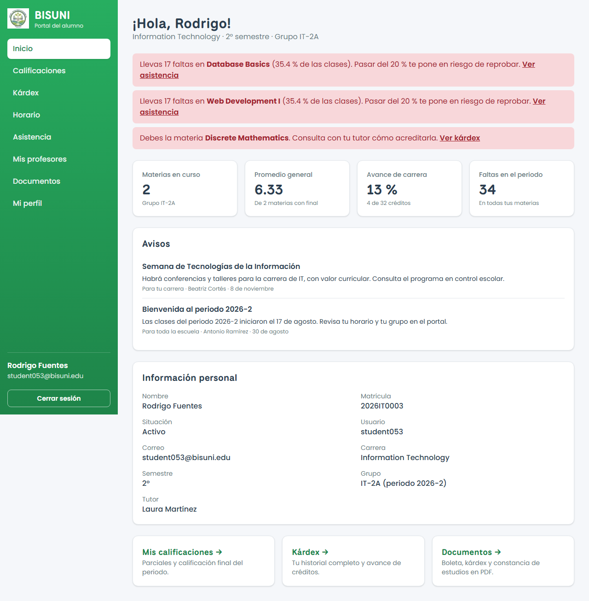
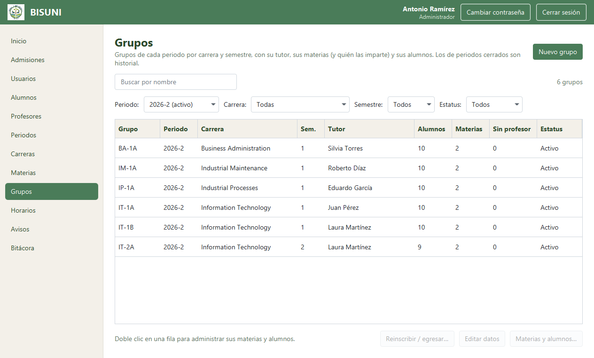
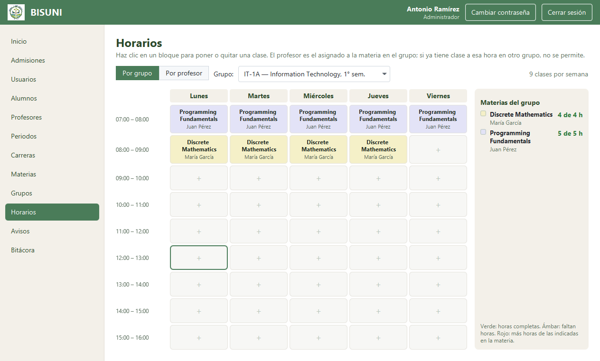
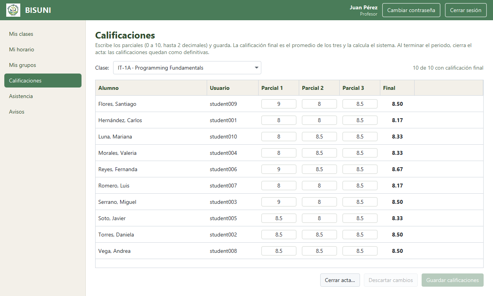
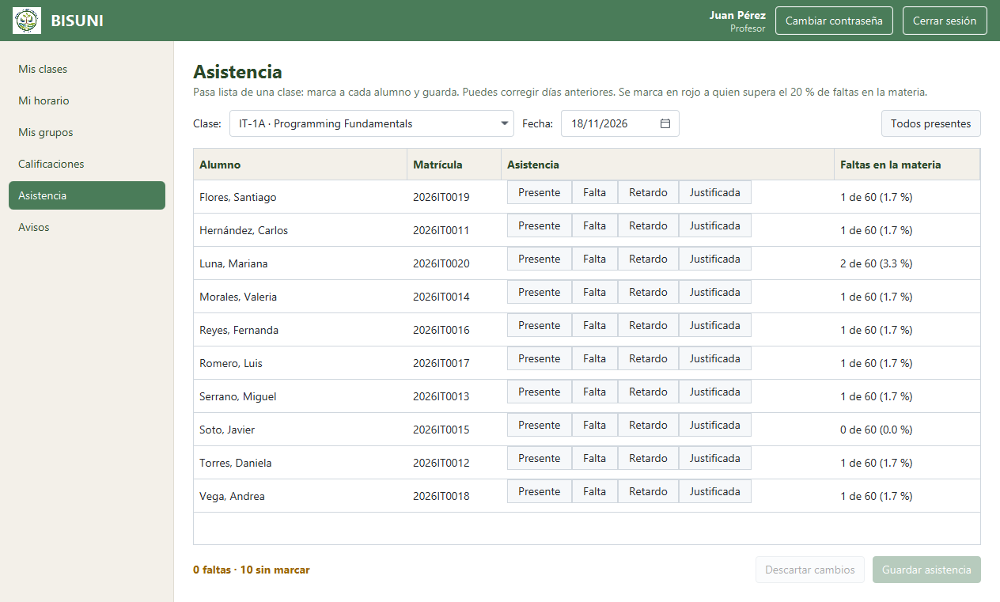
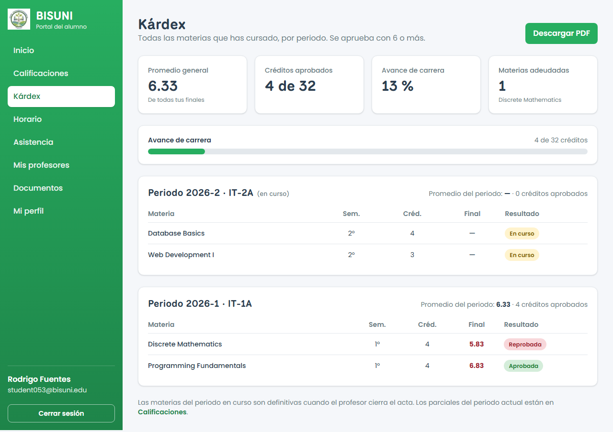
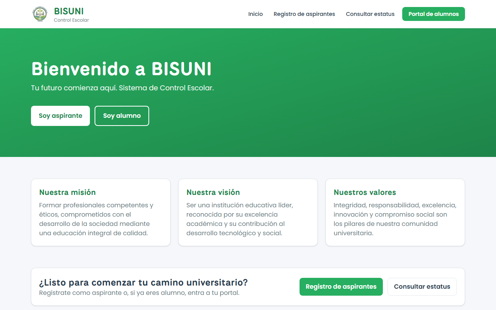
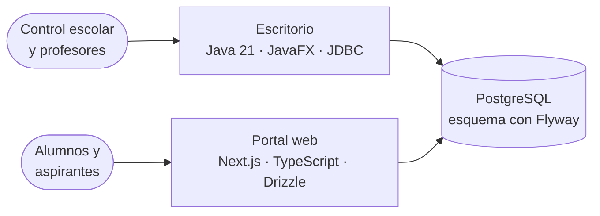

<div align="center">


# BISUNI

**Sistema de control escolar universitario**: una app de escritorio para control escolar y profesores, un portal
web para alumnos y aspirantes, y una base de datos PostgreSQL que comparten.

[](https://github.com/Yamato6/BISUNI-v2/actions/workflows/ci.yml)
[](https://github.com/Yamato6/BISUNI-v2/releases/latest)
[](LICENSE)


</div>

<p align="center">
  
  
</p>

## Qué hace

BISUNI cubre el ciclo completo de un periodo escolar:
1. la convocatoria y la admisión de aspirantes;
2. los grupos, los horarios, las calificaciones, el pase de lista y el cierre de actas;
3. la reinscripción al semestre siguiente y el egreso.

| Quién | Dónde | Qué puede hacer |
|---|---|---|
| **Control escolar** | Escritorio | Panel con alertas · periodos y convocatoria · admisiones con matrícula · carreras, materias, grupos y horarios sin choques · alumnos (bajas, reingresos, egreso) · reinscripción de grupos · usuarios y contraseñas temporales · avisos · bitácora de cambios |
| **Profesores** | Escritorio | Sus clases, horario y grupos · captura de calificaciones y cierre de actas · pase de lista · avisos para sus grupos |
| **Alumnos** | Web | Avisos y alertas de faltas · calificaciones · kárdex con avance de créditos · horario · asistencia · profesores · constancia, kárdex y boleta en PDF |
| **Aspirantes** | Web | Registro en la convocatoria y consulta de estatus con CURP + folio |

<details>
<summary><b>Más capturas</b></summary>

| | |
|---|---|
|  |  |
| Grupos por periodo, con sus materias y alumnos | Horario sin choques y con tope de horas por materia |
|  |  |
| Captura de calificaciones y cierre de actas | Pase de lista con alerta por faltas |
|  |  |
| Kárdex del alumno por periodo | Portada del portal |

Ejemplos de documentos PDF: [constancia](docs/ejemplos/constancia.pdf), [kárdex](docs/ejemplos/kardex.pdf) y
[boleta](docs/ejemplos/boleta.pdf).

</details>

## Cómo está hecho



- **Las reglas importantes viven en la base de datos.** Restricciones y triggers impiden:
  - capturar calificaciones con el acta cerrada;
  - registrar asistencia fuera del periodo;
  - asignar alumnos a grupos de periodos cerrados;
  - que se crucen horarios.

  Así ninguna de las dos apps puede dejar datos incoherentes.
- **Bitácora automática:** cada cambio importante queda registrado con quién lo hizo, venga del escritorio o de la
  web.
- **Seguro por diseño:**
  - contraseñas con bcrypt;
  - SQL siempre parametrizado;
  - cada página del alumno vuelve a validar su cuenta contra la base;
  - contraseñas temporales que obligan a crear una nueva.
- **Más de 200 pruebas automáticas** contra un PostgreSQL real (embebido). Incluyen un flujo completo en el que
  el escritorio admite y califica a un alumno y el alumno lo ve todo en la web.

Más detalle en [arquitectura](docs/arquitectura.md) y [base de datos](docs/base-de-datos.md).

## Pruébalo

### Rápido, con Docker
```bash
git clone https://github.com/Yamato6/BISUNI-v2.git && cd BISUNI-v2
cp .env.example .env               # define DB_PASSWORD (también en DATABASE_URL) y AUTH_SECRET (npx auth secret)
docker compose up -d               # PostgreSQL + esquema + datos de demostración
```

Luego, cada app en su propia terminal, desde la raíz del repositorio:

```bash
cd web && npm install && npm run dev    # portal: http://localhost:3000
cd desktop && ./mvnw javafx:run         # escritorio (requiere Java 21+)
```

¿Sin Docker? Usa un PostgreSQL instalado o la base embebida (`cd desktop && ./mvnw exec:java`). En Windows también
puedes descargar la app de escritorio ya empaquetada desde
[Releases](https://github.com/Yamato6/BISUNI-v2/releases). Todo está en la
[guía de instalación](docs/instalacion.md).

### Cuentas de demostración
Todas usan la contraseña `password123`.

| Rol | Cuenta | Dónde |
|---|---|---|
| Administrador | `admin.master@bisuni.edu` | Escritorio |
| Profesor | `juan.perez@bisuni.edu` | Escritorio |
| Alumno | `student001@bisuni.edu` | Web |
| Alumno con historial de dos periodos | `student051@bisuni.edu` | Web |
| Alumno en riesgo por faltas y con materia adeudada | `student053@bisuni.edu` | Web |
| Aspirante pendiente | CURP `BEXA070312MASLND01` · folio `ASP-000001` | Web → Consultar estatus |

Las cuentas de demostración son solo para conocer el sistema. Una instalación real empieza sin ellas
([instalación](docs/instalacion.md#primer-administrador-solo-en-una-instalación-real)).

## Documentación

| Documento | Para |
|---|---|
| [Manual de usuario](docs/manual-de-usuario.md) | Usar el sistema: el ciclo de un periodo y cada rol |
| [Instalación](docs/instalacion.md) | Instalar la base, el escritorio y la web, en demostración o en serio |
| [Arquitectura](docs/arquitectura.md) | Cómo está construido y por qué |
| [Base de datos](docs/base-de-datos.md) | Diagrama, tablas, triggers y vistas |
| [Desarrollo](docs/desarrollo.md) | Comandos, pruebas y convenciones para contribuir |
| [De la v1 a la v2](docs/historia-v1.md) | Qué cambió respecto a la versión original |
| [Plan y bitácora de fases](docs/PLAN.md) | Decisiones tomadas en cada fase del proyecto |

## Origen

BISUNI empezó como el **Proyecto Integrador I** (TDSM3A, septiembre a diciembre de 2025), que integró
Programación Orientada a Objetos, Bases de Datos y Diseño de Software. Esa v1 usaba MySQL, Java Swing y PHP. Esta
v2 la reescribe por completo y la convierte en un sistema de control escolar completo
([qué cambió](docs/historia-v1.md)).

## Contribuir y licencia

Los issues y los pull requests son bienvenidos: lee [CONTRIBUTING.md](CONTRIBUTING.md). Las vulnerabilidades se
reportan en privado ([SECURITY.md](SECURITY.md)).

Código bajo [licencia MIT](LICENSE). La fuente National Park se distribuye con la
[SIL Open Font License](web/src/app/fonts/OFL.txt).
