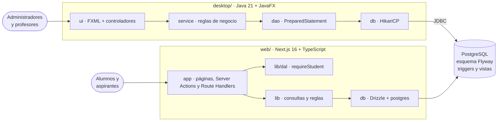

# Arquitectura

Las dos aplicaciones **no se comunican entre sí**: comparten la base de datos.
- **La base** guarda las reglas que no deben romperse: restricciones, triggers de guarda, bitácora y vistas de
  consulta. Así ninguna app puede dejar datos incoherentes.
- **Cada app** pone encima sus reglas de interfaz y de flujo, y traduce los errores de la base a mensajes claros.

## Base de datos (`db/`)
- **Esquema versionado con Flyway** (`db/migrations`). Es la única fuente de verdad: el escritorio no tiene un
  modelo propio y la web genera sus tipos desde la base con `drizzle-kit pull`.
- **Guardas por trigger:**
  - calificaciones solo en el periodo activo y con el acta abierta;
  - asistencia dentro del periodo;
  - alumnos solo en grupos de periodos abiertos.
- **Bitácora:** un trigger genérico (`audit_row`) registra cada cambio con el actor de la sesión (`bisuni.actor`).
- Detalle completo en [base-de-datos.md](base-de-datos.md).

## Escritorio (`desktop/`)
Java 21, JavaFX 21 con el tema [AtlantaFX](https://github.com/mkpaz/atlantafx), JDBC con HikariCP y bcrypt.
Maven Wrapper.

| Paquete | Responsabilidad |
|---|---|
| `config` | Lee la conexión de variables de entorno, `bisuni.properties` o el `.env` |
| `db` | `Database`: pool, `withConnection`, `inTransaction` y `actor(idUsuario)`, que fija `bisuni.actor` en cada conexión para la bitácora |
| `model` | Records inmutables (filas, datos de formularios, enums) |
| `dao` | SQL con `PreparedStatement`; nada de lógica de negocio |
| `service` | Reglas de negocio y permisos por rol. Lanza `ServiceException` con mensajes en español; `SqlErrors` traduce cada restricción de la base por su nombre |
| `session` | Usuario en sesión (`UserSession`) |
| `ui` | Una sola ventana: `Navigator` cambia entre login y shell, `ShellController` arma el menú por rol y cada vista es FXML + controlador. `Async` saca las consultas del hilo de JavaFX |

**Decisiones:**
- **Admisión:** aceptar a un aspirante, cambiar su rol, crear su perfil con matrícula y registrar la inscripción
  ocurren en **una sola transacción**. Además, solo se procesan las filas que cambiaron, con control optimista: si
  otra persona ya lo procesó, se avisa en lugar de duplicar.
- **Calificaciones y asistencia:** se capturan con `INSERT ... ON CONFLICT`. La calificación final la calcula la
  base: es una columna generada.
- **Permisos:** un profesor solo ve y edita las clases que imparte (`group_subject.id_teacher`). Lo revisan los
  servicios y, para calificaciones y asistencia, también los triggers.

## Web (`web/`)
Next.js 16 (App Router), React 19, TypeScript, Drizzle, Auth.js v5 (credenciales), Zod, Tailwind 4 y
`@react-pdf/renderer`.

| Carpeta | Responsabilidad |
|---|---|
| `src/app/(publico)` | Portada, login, registro y estatus de aspirantes |
| `src/app/(alumno)` | Portal del alumno: inicio, calificaciones, kárdex, horario, asistencia, profesores, documentos y perfil |
| `src/app/cambiar-contrasena` | Cambio obligatorio tras una contraseña temporal |
| `src/lib` | Consultas (`server-only`) y reglas puras (con pruebas unitarias) |
| `src/lib/dal.ts` | `requireStudent()`: la verificación de acceso |
| `src/lib/pdf` | Constancia, kárdex y boleta en PDF |
| `src/db/generated` | Esquema de Drizzle generado desde la base; no se edita a mano |

**Seguridad:**
- `proxy.ts` (antes `middleware`) solo hace una revisión optimista de la cookie.
- La verificación real es `requireStudent()`. La llama **cada** página, Server Action y Route Handler del alumno, y
  revisa contra la base en cada petición:
  - que la cuenta siga activa;
  - que siga siendo de alumno;
  - que no tenga baja definitiva;
  - que no deba cambiar su contraseña.
- Así una baja o un restablecimiento de contraseña hechos en el escritorio se aplican de inmediato, sin esperar a
  que la sesión expire.
- El estatus de aspirante se consulta con CURP **y** folio, para que nadie pueda ver el de otra persona solo con
  la CURP.

## Pruebas
- **Las dos suites usan PostgreSQL embebido**, con las migraciones y el seed reales. Ninguna prueba usa mocks de la
  base ni toca tu base de desarrollo.
- **Escritorio:** pruebas de servicios contra la base, incluidos los triggers y la bitácora, más una prueba de humo
  que abre cada vista.
- **Web:** Vitest para reglas y consultas, y Playwright para los flujos en el navegador.
- **Flujo completo** (`web/e2e/flujo-completo.spec.ts`): ejecuta acciones reales del escritorio
  (`desktop/.../dev/DesktopCli.java`) entre pasos del navegador:
  1. un aspirante se registra en la web;
  2. el escritorio lo admite, lo califica, cierra un acta, le pone una falta, publica un aviso y le restablece la
     contraseña;
  3. el alumno lo ve todo en la web.
- Cómo correrlas: [desarrollo.md](desarrollo.md).
