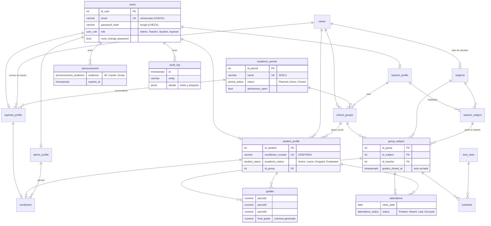

# Base de datos

PostgreSQL 17 o superior. El esquema completo está en
[`db/migrations/V1__schema.sql`](../db/migrations/V1__schema.sql) y se aplica con Flyway. Las dos aplicaciones lo
comparten: el escritorio con JDBC y la web con Drizzle. La web genera sus tipos con `drizzle-kit pull` y no define
tablas propias.

Las reglas que no deben romperse viven **en la base**, no solo en las aplicaciones. Ninguna app puede dejar datos
incoherentes, aunque tenga un error.

## Diagrama

## Tablas

| Tabla | Qué guarda | Reglas principales |
|---|---|---|
| `users` | Cuentas de todos los roles | Email en minúsculas y único; `password_hash` debe ser bcrypt; `must_change_password` para contraseñas temporales |
| `admin_profile`, `teacher_profile`, `student_profile`, `aspirant_profile` | Datos propios de cada rol (uno por usuario) | — |
| `career` | Carreras | `code` de 2 a 4 letras (forma la matrícula); `total_semesters` |
| `academic_period` | Periodos escolares | Un solo periodo `Active` (índice único parcial); un periodo cerrado no puede tener convocatoria abierta |
| `subjects` | Materias del plan de cada carrera | `weekly_hours` = bloques de horario por semana |
| `school_groups` | Grupos | Pertenecen a un periodo; el nombre se repite entre periodos (`UNIQUE (id_period, group_name)`) |
| `student_profile` | Alumnos | Matrícula única con formato; solo un alumno `Active` puede tener grupo; el grupo debe ser de su carrera (FK compuesta) |
| `aspirant_profile` | Solicitudes de ingreso | CURP `CHAR(18)` única con formato oficial; ligada a la convocatoria (`id_period`) |
| `enrollment` | Inscripción de un aspirante aceptado | Un aspirante, un alumno; `approved_by` = administrador que lo aceptó |
| `teacher_subject` | Materias que cada profesor puede impartir | — |
| `group_subject` | Materias de cada grupo, su profesor y su **acta** | El profesor debe estar habilitado (FK a `teacher_subject`); `grades_closed_at/by` van juntos |
| `time_slots` | Bloques horarios (07:00–16:00) | Catálogo fijo que se inserta en la migración |
| `schedule` | Horario de los grupos | Sin choques del grupo ni del profesor dentro del periodo; si cambia el profesor de la materia, el horario se actualiza en cascada |
| `grades` | Calificaciones | Parciales de 0 a 10; `final_grade` es una columna generada (promedio); una fila por alumno, grupo y materia |
| `attendance` | Pase de lista | Una fila por alumno, clase y fecha |
| `announcement` | Avisos | La audiencia (todos, carrera o grupo) debe coincidir con su destino; el vencimiento es posterior a la publicación |
| `audit_log` | Bitácora de cambios | La llenan los triggers |

## Reglas que hace cumplir la base

### Guardas por trigger
| Trigger | Regla | Restricción que reporta |
|---|---|---|
| `grades_guard` | Solo se capturan calificaciones de grupos del periodo **activo** y con el acta **abierta** | `grades_period_not_active`, `grades_acta_closed` |
| `attendance_guard` | La asistencia solo se registra en el periodo activo y con fechas dentro del periodo | `attendance_period_not_active`, `attendance_date_out_of_period` |
| `student_group_guard` | No se asignan alumnos a grupos de periodos cerrados | `student_group_period_closed` |
| `schedule_set_period` | Copia el periodo del grupo al horario, para detectar choques del profesor dentro del periodo | — |

Los triggers lanzan sus errores con `RAISE ... USING CONSTRAINT = 'nombre'`. Así las aplicaciones los traducen a un
mensaje en español igual que cualquier otra restricción: `desktop/.../service/SqlErrors.java`.

### Bitácora (`audit_log`)
La función `audit_row(entidad, columnas vigiladas, columnas clave)` registra las altas y los cambios en:
- usuarios;
- carreras;
- periodos;
- aspirantes;
- alumnos;
- materias de grupo (profesor y acta);
- calificaciones.

Para cada cambio guarda el antes y el después de las columnas vigiladas. Las contraseñas se registran solo como
"cambiada".

El **actor** sale del ajuste de sesión `bisuni.actor`:
- el escritorio lo fija en cada conexión con `db.actor(idUsuario)`;
- la web lo fija con `asActor()`.

### Matrícula
`next_enrollment_number(carrera, año)` entrega la siguiente matrícula `{año}{clave}{consecutivo}`, por ejemplo
`2026IT0012`. Usa un candado para que dos admisiones simultáneas no tomen el mismo número. El año es el de la
convocatoria del aspirante o el del periodo activo.

## Vistas
| Vista | Para qué |
|---|---|
| `v_student_gpa` | Promedio general del alumno. Solo cuenta las materias con calificación final; el promedio no se guarda |
| `v_kardex` | Historial por alumno, periodo y materia. Resultado: aprobada, reprobada o en curso, y si ya es definitiva (acta cerrada o periodo cerrado) |
| `v_attendance_summary` | Clases, faltas y porcentaje por alumno y materia |
| `v_teacher_schedule` | Horario de cada profesor |

Se aprueba con 6: función `passing_grade()`.

## Datos de demostración
[`db/seed/R__seed_dev.sql`](../db/seed/R__seed_dev.sql) es una migración *repeatable* de Flyway. Contiene:
- dos periodos: 2026-1 cerrado con historial y 2026-2 activo con convocatoria;
- cuatro carreras;
- alumnos con reprobadas, una baja definitiva y un alumno en riesgo por faltas;
- avisos y aspirantes pendientes.

Empieza con `TRUNCATE` y desactiva la bitácora y las guardas mientras carga el historial (`bisuni.seed = 'on'`).
**No se usa en producción.**

## Cambios al esquema
1. Nunca se edita una migración ya aplicada: Flyway guarda su checksum. Cada cambio va en una migración nueva,
   `db/migrations/V2__descripcion.sql`.
2. Si agrega restricciones, su mensaje va en `SqlErrors` (escritorio).
3. En `web/`, `npm run db:pull -- --embebida` regenera `src/db/generated`.
4. Las pruebas de ambas apps aplican las migraciones reales en un PostgreSQL embebido, así que cubren el cambio
   sin pasos extra.
