# Manual de usuario

| Rol | Dónde trabaja | Sección |
|---|---|---|
| Administrador (control escolar) | App de escritorio | [Administrador](#administrador) |
| Profesor | App de escritorio | [Profesor](#profesor) |
| Alumno | Portal web | [Alumno](#alumno) |
| Aspirante | Portal web | [Aspirante](#aspirante) |

Con los datos de demostración, todas las cuentas usan la contraseña `password123`. Las cuentas están en el
[README](../README.md#pruébalo).

---

## El ciclo de un periodo escolar
Así encajan las piezas a lo largo de un semestre:

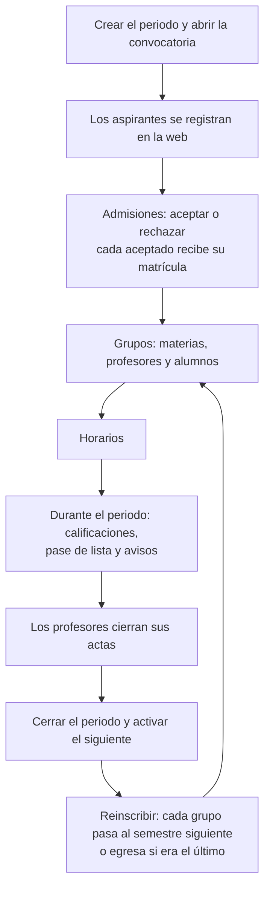

---

## Administrador
Al entrar, el menú tiene:
- Inicio y Admisiones;
- Usuarios, Alumnos y Profesores;
- Periodos, Carreras, Materias, Grupos y Horarios;
- Avisos y Bitácora.

Si alguien te restableció la contraseña, primero se te pide crear una nueva.

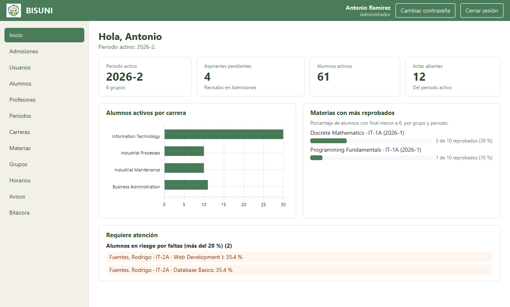

### Inicio
Resume el periodo activo:
- grupos, aspirantes pendientes, alumnos activos y actas abiertas;
- alumnos por carrera;
- las materias con más reprobados.

**Requiere atención** avisa de:
- grupos con materias sin profesor;
- horarios incompletos;
- alumnos con más del 20 % de faltas.

### Periodos
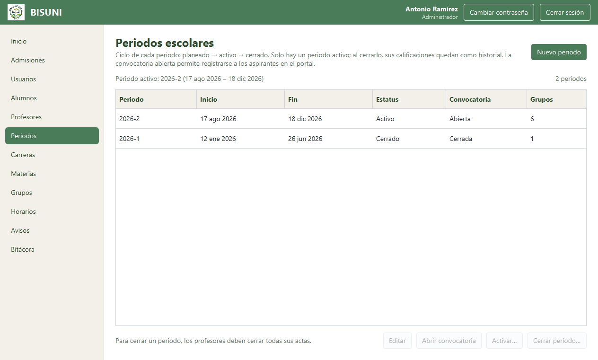

1. **Nuevo periodo** con su nombre (p. ej. `2027-1`) y sus fechas. No puede traslaparse con otro.
2. **Abrir convocatoria** para que los aspirantes puedan registrarse en el portal en ese periodo.
3. **Activar…** cuando empiecen las clases. Solo hay un periodo activo; las calificaciones y la asistencia solo se
   capturan en él.
4. **Cerrar periodo…** al terminar. Para cerrarlo, los profesores deben haber cerrado todas sus actas; si falta
   alguna, el sistema te dice cuáles. Un periodo cerrado queda como historial y ya no se modifica.

### Carreras y materias
- **Carreras:** nombre, **clave** (2 a 4 letras, forma la matrícula: `2026IT0001`) y número de semestres. El
  número de semestres marca cuándo egresa un grupo. Una carrera inactiva deja de aparecer en el registro de
  aspirantes.
- **Materias:** carrera, semestre, créditos y **horas por semana**. Las horas por semana son los bloques que el
  horario le permite. Los profesores que pueden impartir cada materia se habilitan en Profesores → **Materias…**.

### Admisiones
Lista a los aspirantes de la convocatoria. Cambia el estatus en la columna **Estatus** (Aceptado o Rechazado) y
pulsa **Guardar cambios**.

Al aceptar a alguien, el sistema hace todo en un solo paso:
- lo convierte en alumno;
- le da su matrícula;
- registra quién lo aceptó.

Aceptar no se puede revertir. Si otra persona ya había procesado al mismo aspirante, se te avisa en lugar de
duplicarlo.

### Grupos
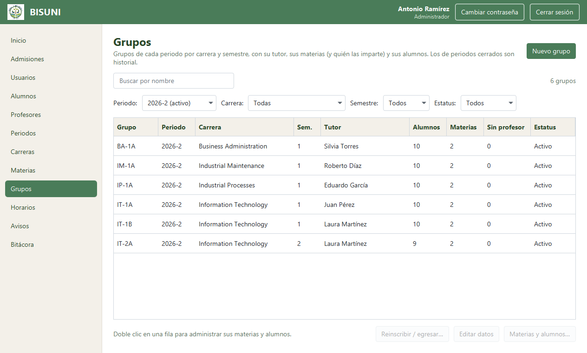

- **Nuevo grupo:** periodo, carrera, semestre y tutor.
- **Materias y alumnos…** (o doble clic en el grupo):
  - asigna el profesor de cada materia (solo aparecen los habilitados);
  - agrega o quita alumnos (solo alumnos activos de la misma carrera);
  - reabre un acta si un profesor necesita corregir una calificación.
- **Reinscribir / egresar…:** úsalo al pasar de un periodo al siguiente.
  - Crea el grupo del semestre siguiente en el nuevo periodo, con sus materias, y pasa a los alumnos activos.
  - Si el grupo ya estaba en el último semestre, marca como egresados a quienes no deben materias.
- Los grupos de periodos cerrados son historial: se pueden consultar, pero no modificar.

### Horarios
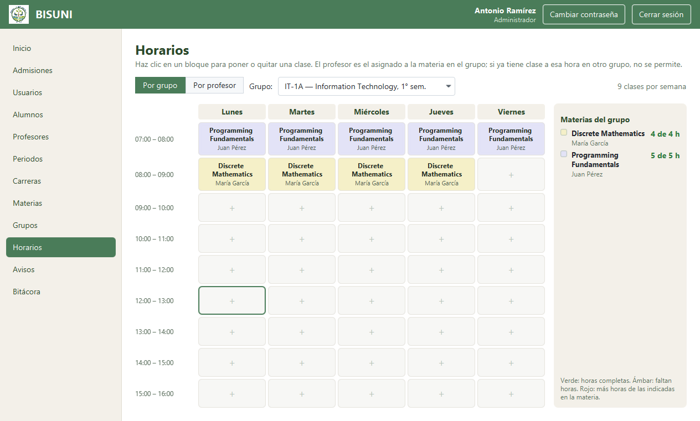

Elige un grupo y haz clic en un bloque para poner o quitar una clase. El profesor es el que tiene asignada la
materia en ese grupo.

El sistema no permite:
- que el grupo o el profesor tengan dos clases a la misma hora;
- pasarse de las horas por semana de la materia.

El panel derecho muestra cuántas horas lleva cada materia. **Por profesor** muestra el horario de un docente.

### Usuarios, alumnos y profesores
- **Usuarios:** alta de personal y alumnos, edición y estatus de la cuenta. **Restablecer contraseña…** genera una
  contraseña temporal que se muestra una sola vez; la persona debe cambiarla al entrar, tanto en el escritorio
  como en la web.
- **Alumnos:** matrícula, grupo, situación y promedio. El promedio se calcula de sus calificaciones finales.
  **Cambiar situación…** sirve para:
  - dar una baja temporal o definitiva (el alumno sale de su grupo; con baja definitiva ya no entra al portal);
  - registrar un reingreso;
  - marcar un egreso.
- **Profesores:** perfil (especialidad y teléfono) y las materias que puede impartir.

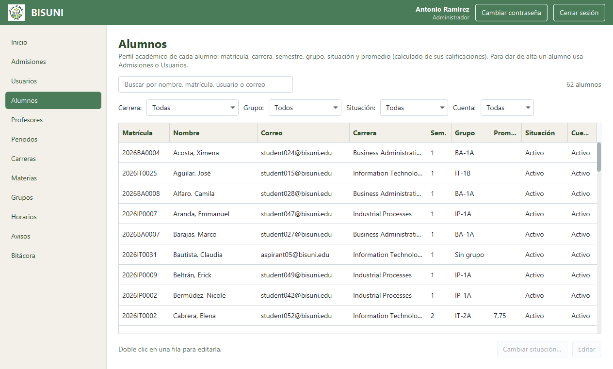

### Avisos
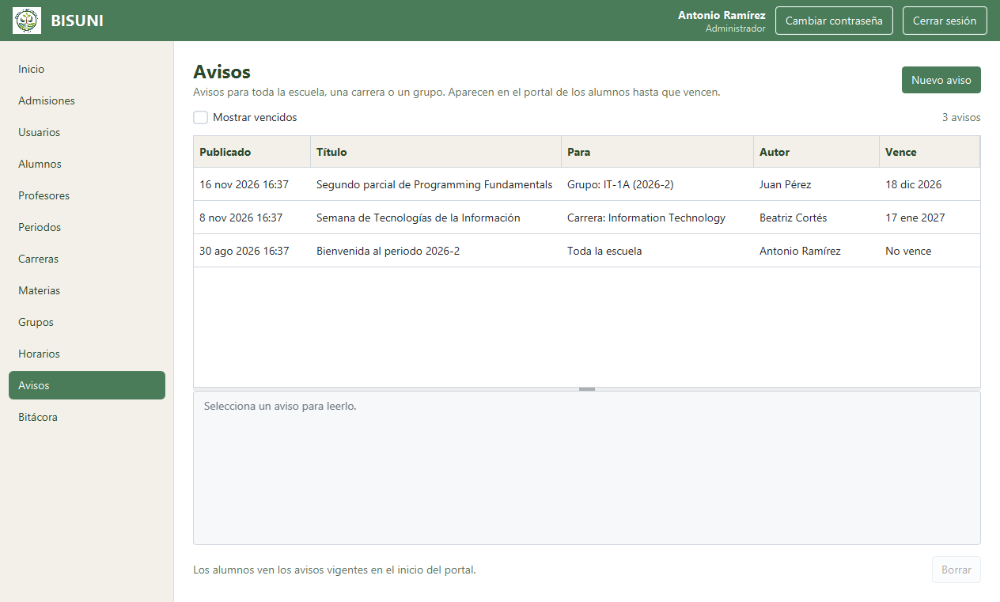

**Nuevo aviso** para toda la escuela, una carrera o un grupo, con fecha de vencimiento opcional. Los alumnos ven
los avisos vigentes en el inicio del portal.

### Bitácora
Muestra quién cambió qué y cuándo. Puedes filtrarla por fechas, tipo de registro o texto. La registra la base de
datos, así que incluye también los cambios hechos desde el portal web. Al seleccionar un renglón se ve el detalle,
por ejemplo "Parcial 1: 8.50 → 10.00". Las contraseñas solo aparecen como "cambiada".

---

## Profesor
Su menú tiene Mis clases, Mi horario, Mis grupos, Calificaciones, Asistencia y Avisos. Solo ve las materias que
imparte.

### Calificaciones y actas
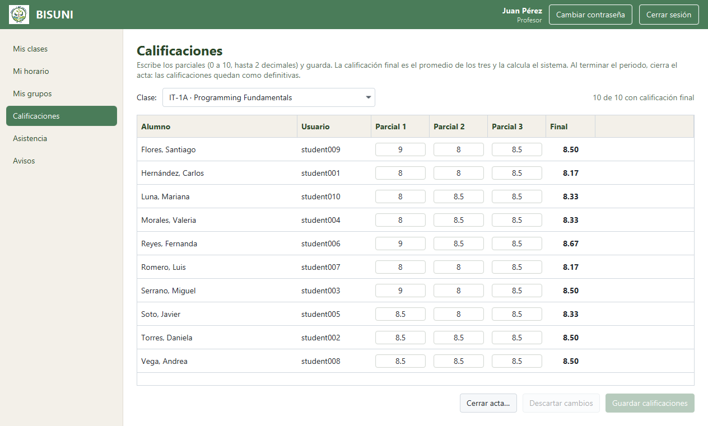

1. Elige la clase (grupo y materia).
2. Escribe los tres parciales (de 0 a 10, hasta 2 decimales) y pulsa **Guardar calificaciones**. La final es el
   promedio de los tres; se aprueba con 6.
3. Al terminar el periodo, pulsa **Cerrar acta…**. Pide que todos los alumnos tengan sus tres parciales. Con el
   acta cerrada las calificaciones quedan **definitivas**: aparecen así en el kárdex del alumno y ya no se pueden
   modificar. Si hace falta corregir algo, control escolar puede reabrirla.

### Asistencia
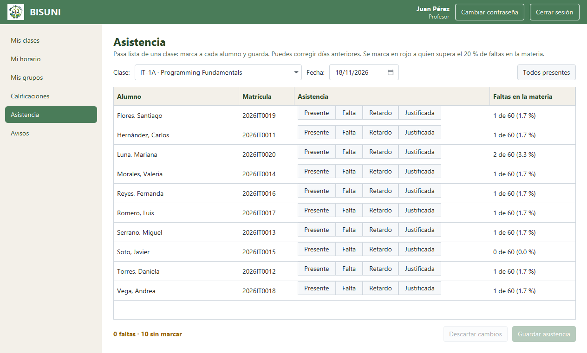

1. Elige la clase y la fecha. Por omisión es el último día con clase según el horario.
2. Marca a cada alumno como Presente, Falta, Retardo o Justificada. **Todos presentes** marca a todos de un
   golpe.
3. Pulsa **Guardar asistencia**.

Puedes corregir días anteriores dentro del periodo, pero no registrar fechas futuras. Se marca en rojo a quien
supera el 20 % de faltas en la materia; el alumno también ve esa alerta en el portal.

### Avisos
Puedes publicar avisos para los grupos donde das clase.

---

## Alumno
Entra en el portal web con su correo institucional. Si control escolar le restableció la contraseña, primero
debe crear una nueva.

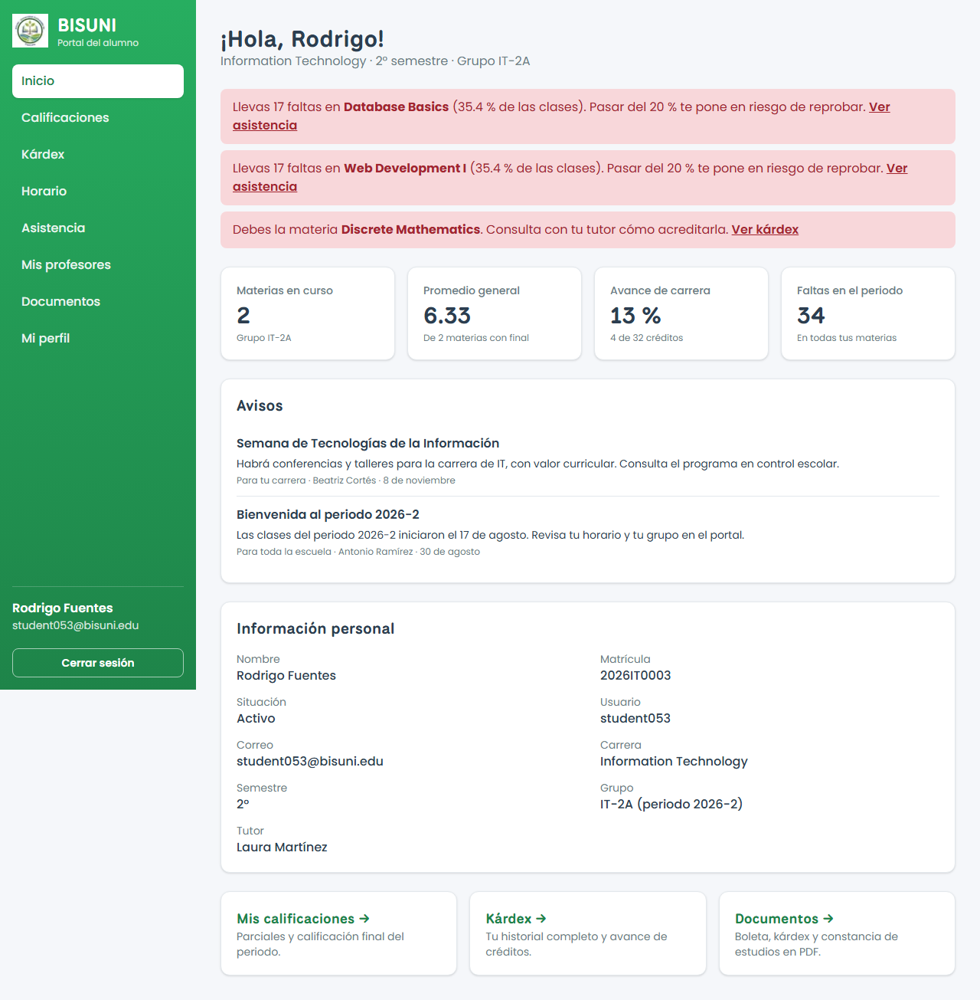

| Página | Qué muestra |
|---|---|
| **Inicio** | Avisos vigentes; alertas de faltas y de materias adeudadas; promedio, avance de carrera y datos personales |
| **Calificaciones** | Parciales y final de las materias del periodo, con su profesor |
| **Kárdex** | Historial completo por periodo, con resultado (aprobada, reprobada o en curso), promedio por periodo y créditos aprobados frente al total de la carrera |
| **Horario** | Clases de la semana de su grupo |
| **Asistencia** | Faltas y porcentaje por materia, con el detalle de fechas |
| **Mis profesores** | Profesores de sus materias y su tutor |
| **Documentos** | Constancia de estudios (o de egreso), kárdex y boleta por periodo, en PDF ([ejemplo](ejemplos/constancia.pdf)) |
| **Mi perfil** | Cambiar su nombre y su contraseña |

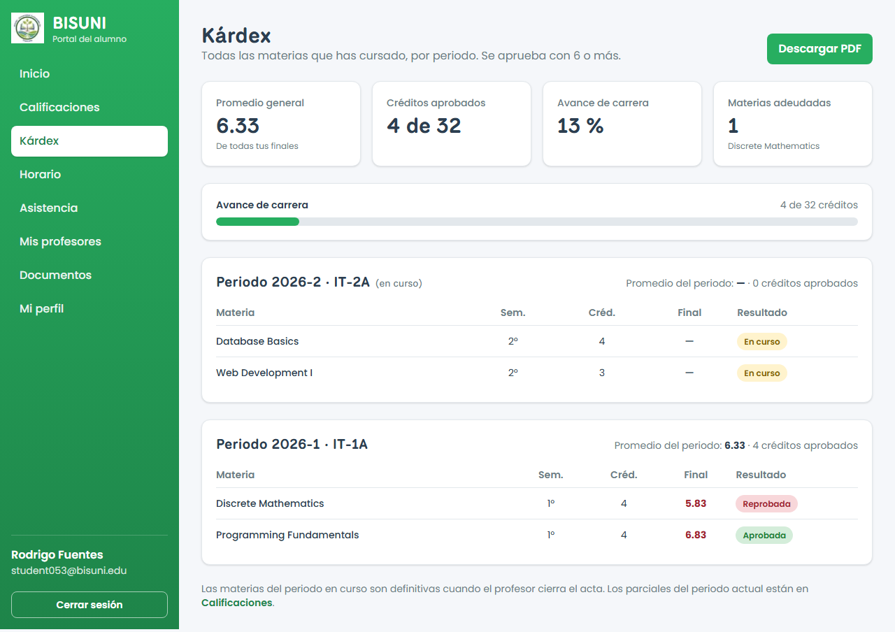

Un alumno egresado puede seguir consultando su kárdex y sus documentos. Uno con baja definitiva ya no puede entrar.

---

## Aspirante
1. En la portada del portal, **Registro de aspirantes**. Solo está disponible si hay una convocatoria abierta.
2. Llena sus datos, su CURP y la carrera de interés, y crea su contraseña.
3. Al terminar recibe un **folio** (p. ej. `ASP-000123`). Debe guardarlo.
4. En **Consultar estatus** ve si su solicitud está pendiente, aceptada o rechazada, con su **CURP y su folio**.
5. Cuando lo aceptan, entra al portal con su correo y su contraseña como alumno.

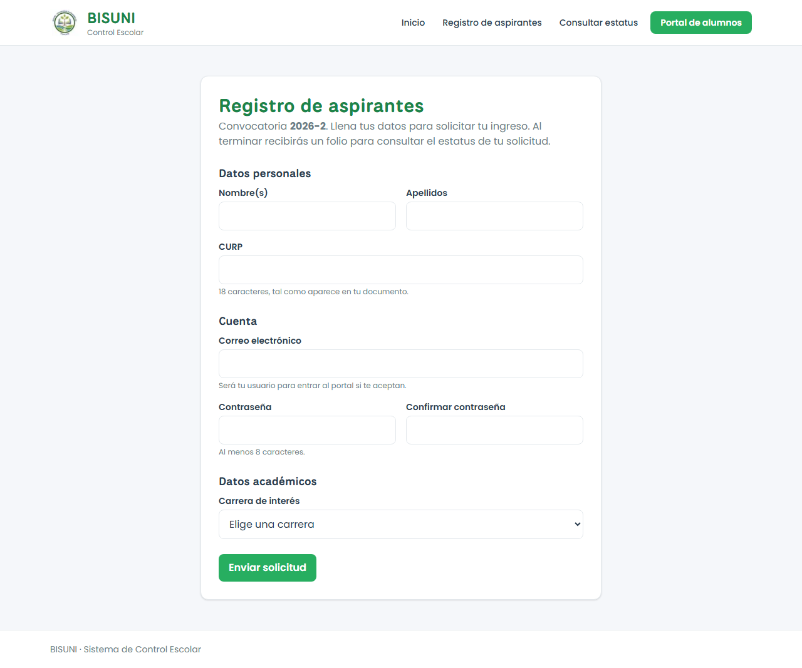
